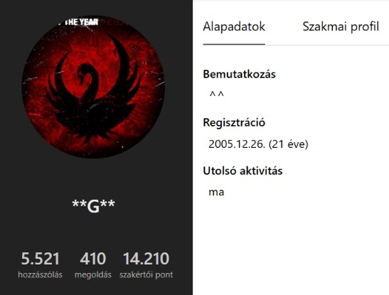

#  Overview

I have been an active member of the [prog.hu](https://prog.hu) community for more than 20 years, regularly solving programming problems and contributing to discussions.

This page presents a verifiable overview of my public forum activity, allowing visitors to review my solved problems without registration.

The dataset was compiled from my own public posts and solutions using a custom scraper developed with AI assistance.

## Prog.Hu - accepted answers by `**G**`

**408 accepted answers** &nbsp;·&nbsp; 14,210 expert points &nbsp;·&nbsp; 2006-08-23 &rarr; 2025-04-14 &nbsp;·&nbsp; **#3** in C++ &nbsp;·&nbsp; **#7** in C

`C++` &nbsp;·&nbsp; `C`

[profile on prog.hu](https://prog.hu/azonosito/%2A%2AG%2A%2A?pop=1) &nbsp;·&nbsp; [Megoldasok tab](https://prog.hu/azonosito/%2A%2AG%2A%2A?pop=1&tab=solutions) &nbsp;·&nbsp; [raw numbers: data/solutions.csv](data/solutions.csv)

A snapshot of the answers I provided on [prog.hu](https://prog.hu) - Hungary's biggest programming forum - that were accepted as the solution of the question. Every title below is an **English translation** of the original Hungarian question and links straight to the thread.

| | |
|---|---|
| **Accepted answers** | **408** (the profile badge reports 410 - the 2 missing ones are almost certainly deleted questions) |
| **Period** | 2006-08-23 &rarr; 2025-04-14 (19 active years) |
| **Expert points** *(szakertoi pont)* | 14,210 |
| **Comments** *(hozzaszolas)* | 5,520 |
| **Registered** | 2005.12.26. (21 years) |
| **Answers inside these threads** | 3,809 (9.3 per thread on average) |
| **Topics covered** | 148 distinct prog.hu tags |
| **Global ranking** | **#3** in C++ · **#7** in C (based on solved problems) |
| **Sources** | [profile](https://prog.hu/azonosito/%2A%2AG%2A%2A?pop=1) - [Megoldasok tab](https://prog.hu/azonosito/%2A%2AG%2A%2A?pop=1&tab=solutions) |

*Order: newest first - the same order prog.hu shows on its Megoldasok (solutions) tab.*

## Screenshot provenance

The profile picture at the top was taken from prog.hu with a logged-in session (`take_screenshots.py`) and kept as a local file; the owner crops it by hand to the relevant part. File date: 2026-11-10T15:11:34+00:00.

Counters as read from the site by `take_screenshots.py --stats`: 410 megoldas, 5,520 hozzaszolas, 14,210 szakertoi pont.

## Achievements

- **408 accepted answers** on prog.hu, each marked as the solution of its question, and all 408 of them translated into English below.
- The profile badge counts **410** megoldas, **408** are listed here: the **2** missing entries are almost certainly threads whose **question was later deleted** (a deleted question drops out of the Megoldasok tab, so it cannot be listed or linked).
- **Almost two decades of activity**: from 2006-08-23 to 2025-04-14; the profile was opened 2005.12.26. (21 éve).
- **3,809 answers** written inside these threads (9.3 per question on average; the most discussed single thread drew 39).
- **14,210 expert points** *(szakertoi pont)* accumulated on the site.
- Busiest year **2014** with **81** accepted answers.
- **Top 3 in C++** - **#3** in prog.hu's global C++ ranking, ordered by collected expert points (szakertoi pont).
- **Top 7 in C** - **#7** in prog.hu's global C ranking, ordered by collected expert points (szakertoi pont).

### Activity by year

| Year | Accepted answers | |
|---|---|---|
| 2006 |  2 | `█` |
| 2007 |  5 | `██` |
| 2008 |  1 | `█` |
| 2009 | 17 | `███████` |
| 2010 | 45 | `███████████████████` |
| 2011 | 11 | `█████` |
| 2012 | 28 | `████████████` |
| 2013 | 67 | `████████████████████████████` |
| 2014 | 81 | `██████████████████████████████████` |
| 2015 | 38 | `████████████████` |
| 2016 | 22 | `█████████` |
| 2017 | 20 | `████████` |
| 2018 | 26 | `███████████` |
| 2019 | 17 | `███████` |
| 2020 | 17 | `███████` |
| 2021 |  5 | `██` |
| 2022 |  2 | `█` |
| 2023 |  3 | `█` |
| 2024 |  0 | `` |
| 2025 |  1 | `█` |

*Every year of the period is listed: no accepted answer was made in 2024, shown as **0**. 20 years in the span, 19 of them active.*

## The complete list (408 accepted answers)

*`#` is the position in the list (1 = most recent), `Date` is when the answer was accepted (YYYY-MM-DD), `Name` is the English translation of the Hungarian question title and a link to the thread. The original Hungarian titles are kept in [data/solutions.csv](data/solutions.csv).*

| # | Date | Name |
|---|---|---|
| 1 | 2025-04-14 | [C++: the first few elements of an array keep changing - but why?](https://prog.hu/tudastar/216463/c-megvaltozik-egy-tomb-kezdo-nehany-eleme-de-mitol) |
| 2 | 2023-06-28 | [Using unique_ptr correctly when transferring ownership](https://prog.hu/tudastar/215189/a-unique-ptr-pontos-hasznalata-tulajdonjog-atadasakor) |
| 3 | 2023-06-22 | [C++20 does not compile an unused template method, C++14 does](https://prog.hu/tudastar/215170/c-20-ban-ha-nem-hasznalom-a-sablonmetodust-akkor-se-forditja-le-c-14-ben-megy) |
| 4 | 2023-05-04 | [Arduino interrupt anomaly](https://prog.hu/tudastar/215043/arduino-interrupt-anomalia) |
| 5 | 2022-05-27 | [Segmentation fault in C++](https://prog.hu/tudastar/213776/segmentation-fault-c) |
| 6 | 2022-01-03 | [Passing a callback function as a parameter](https://prog.hu/tudastar/213019/callback-fuggveny-parameterkent-valo-atadasa) |
| 7 | 2021-11-03 | [SDL2 error](https://prog.hu/tudastar/212704/sdl2-hiba) |
| 8 | 2021-07-31 | [C++ dependent default template argument](https://prog.hu/tudastar/212203/c-dependent-default-template-argument) |
| 9 | 2021-06-21 | [Crash when erasing from a map](https://prog.hu/tudastar/212015/crash-map-bol-valo-torles-soran) |
| 10 | 2021-03-02 | [Which shape has the larger area?](https://prog.hu/tudastar/211257/melyik-alakzat-terulete-nagyobb) |
| 11 | 2021-01-06 | [Changing the mouse cursor](https://prog.hu/tudastar/210876/kurzor-modositasa) |
| 12 | 2020-12-25 | [Building C++ source so that it also runs on another machine](https://prog.hu/tudastar/210791/c-forraskod-buildelese-ugy-hogy-mas-gepen-is-mukodjon) |
| 13 | 2020-12-23 | [C++ template for two different and for identical template arguments](https://prog.hu/tudastar/210797/c-sablon-2-eltero-es-azonos-sablonparameterre-is) |
| 14 | 2020-09-03 | [C++: copying code into a new project - reason for the difference](https://prog.hu/tudastar/210017/c-programkod-masolasa-uj-projektbe-kulonbseg-oka) |
| 15 | 2020-07-02 | [Filtering measurement results](https://prog.hu/tudastar/209653/meresi-eredmenyek-szurese) |
| 16 | 2020-06-19 | [Creating a PNG from a JPG while resizing](https://prog.hu/tudastar/209556/jpg-bol-png-keszitese-atmeretezessel) |
| 17 | 2020-06-09 | [Concatenating char arrays](https://prog.hu/tudastar/209506/a-char-osszefuzese) |
| 18 | 2020-06-07 | [Trouble creating a class object in C++](https://prog.hu/tudastar/209505/osztalyobjektum-letrehozasi-gond-c-ban) |
| 19 | 2020-05-29 | [Image display problem in C++](https://prog.hu/tudastar/209414/kepmegjelenitesi-problema-c-ban) |
| 20 | 2020-05-28 | [Qt C++ QPushButton](https://prog.hu/tudastar/209416/qt-c-qpushbutton) |
| 21 | 2020-05-17 | [How to create graphical objects in C++?](https://prog.hu/tudastar/209331/c-ban-hogyan-lehet-grafikus-objektumokat-letrehozni) |
| 22 | 2020-05-11 | [Explanation of using a pointer-list class](https://prog.hu/tudastar/209266/pointer-lista-osztaly-hasznalat-magyarazat) |
| 23 | 2020-05-11 | [Reading from a file into a linked list in C++](https://prog.hu/tudastar/209267/fajlbol-beolvasas-lancolt-listaba-c) |
| 24 | 2020-05-09 | [Explaining a C++ function](https://prog.hu/tudastar/209250/c-fuggveny-magyarazat) |
| 25 | 2020-04-19 | [Wemos D1 mini: why is the pin value different every time?](https://prog.hu/tudastar/209089/wemos-d1-mini-pin-erteke-miert-mas-mindig) |
| 26 | 2020-03-16 | [Visual C++ compiles differently after CUDA is installed](https://prog.hu/tudastar/208791/visual-c-mashogy-fordit-a-cuda-telepitese-utan) |
| 27 | 2020-03-12 | [Qt application will not start although every DLL is present](https://prog.hu/tudastar/208759/qt-nem-indul-az-alkalmazas-pedig-minden-dll-bent-van) |
| 28 | 2020-03-09 | [Shuffling the parameters of a constructor](https://prog.hu/tudastar/208733/konstruktor-parametereinek-kevergetese) |
| 29 | 2019-12-23 | [Name of the program that calls the application](https://prog.hu/tudastar/208121/alkalmazas-hivo-program-neve) |
| 30 | 2019-11-29 | [Why is it not computed? It returns 0](https://prog.hu/tudastar/207939/miert-nem-szamolja-ki-0-at-ad-vissza) |
| 31 | 2019-10-30 | [Where is the bug in the method override below?](https://prog.hu/tudastar/207649/hol-a-hiba-az-alabbi-metodus-feluldefinialasnal) |
| 32 | 2019-10-28 | [MySQL accented characters (phpMyAdmin & C++)](https://prog.hu/tudastar/207603/mysql-ekezetes-karakterek-phpmyadmin-c) |
| 33 | 2019-10-24 | [C++ homework assignment](https://prog.hu/tudastar/207582/beadando-feladat-c) |
| 34 | 2019-10-12 | [How to make lower- and upper-case letters equal? (C++)](https://prog.hu/tudastar/207488/hogyan-lehet-egyenlove-tenni-a-kis-es-nagy-betuket-c) |
| 35 | 2019-10-08 | [Creating new files under new names in Code::Blocks?](https://prog.hu/tudastar/207447/uj-fajlokat-uj-nevvel-letrehozni-a-codeblocks-ban) |
| 36 | 2019-09-30 | [Illegal memory reference error - why?](https://prog.hu/tudastar/207367/illegalis-mem-hivatkozas-hiba-vajon-miert) |
| 37 | 2019-09-27 | [Raspberry Pi interrupt delay v0.2](https://prog.hu/tudastar/207343/raspberry-pi-interrupt-delay-v0-2) |
| 38 | 2019-09-14 | [Why does the error handling not work?](https://prog.hu/tudastar/207262/miert-nem-jo-a-hiba-kezeles) |
| 39 | 2019-08-06 | [MySQL from C++](https://prog.hu/tudastar/206998/mysql-c) |
| 40 | 2019-07-14 | [Running several functions at the same time](https://prog.hu/tudastar/206804/tobb-fuggveny-futtatasa-egyszerre) |
| 41 | 2019-06-29 | [C++ Win32 ListView column sorting problem](https://prog.hu/tudastar/206671/c-win32-listview-oszlop-rendezes-problema) |
| 42 | 2019-06-24 | [Appending a different type to a C++ vector](https://prog.hu/tudastar/206621/c-vector-append-eltero-tipusbol) |
| 43 | 2019-06-02 | [Errors in an Arduino program](https://prog.hu/tudastar/206457/arduino-program-hibak) |
| 44 | 2019-05-30 | [C++ pragma access at run time](https://prog.hu/tudastar/206436/c-pragma-hozzaferes-futas-alatt) |
| 45 | 2019-05-02 | [Dangling pointer from a function?](https://prog.hu/tudastar/206124/dangling-pointer-fuggveny) |
| 46 | 2018-12-04 | [Segmentation fault when accessing a field of a 2D array](https://prog.hu/tudastar/204660/segmentation-fault-2d-tomb-mezo-eleresenel) |
| 47 | 2018-11-09 | [Visual C++ 2017 - debugging without a debugger](https://prog.hu/tudastar/204349/visual-c-2017-debuggolas-debugger-nelkul) |
| 48 | 2018-11-08 | [Why does the default constructor run?](https://prog.hu/tudastar/204320/miert-fut-le-a-default-konstruktor) |
| 49 | 2018-11-08 | [Filling an array in C](https://prog.hu/tudastar/204324/tomb-feltoltese-c-ben) |
| 50 | 2018-09-28 | [C++ 'undefined reference' error?](https://prog.hu/tudastar/203914/c-undefined-reference-to) |
| 51 | 2018-09-06 | [Getting an HWND from its class name](https://prog.hu/tudastar/203478/hwnd-classnn-bol) |
| 52 | 2018-09-02 | [Struct in C++](https://prog.hu/tudastar/203620/struktura-c) |
| 53 | 2018-07-26 | [Bug in the (int) cast for the value 0.7](https://prog.hu/tudastar/203247/int-atalakitas-hiba-0-7-eseteben) |
| 54 | 2018-07-03 | [Mouse vs touch message from Delphi under OpenGL](https://prog.hu/tudastar/203039/mouse-vs-touch-message-delphi-opengl-alol) |
| 55 | 2018-06-18 | [Two identical characters in a C++ string](https://prog.hu/tudastar/202869/c-stringbe-ket-ugyanolyan-karakter) |
| 56 | 2018-06-13 | [C++: reading into a struct using a vector?](https://prog.hu/tudastar/202834/c-beolvasas-sturukturaba-vektorral) |
| 57 | 2018-06-08 | [Sorting structs into order in C++](https://prog.hu/tudastar/202762/c-sorrendbe-rendezes-struktura) |
| 58 | 2018-06-06 | [C++ isalpha with accented characters](https://prog.hu/tudastar/202737/c-isalpha-ekezetes-karakterek) |
| 59 | 2018-06-04 | [C++ with several template parameters](https://prog.hu/tudastar/202677/c-tobb-template-parameter-eseten) |
| 60 | 2018-06-01 | [C++ random number generator bug?](https://prog.hu/tudastar/202658/c-random-szam-generator-hiba) |
| 61 | 2018-05-27 | [C++ question about reading from a file](https://prog.hu/tudastar/202598/c-fajlbol-olvasas-kerdes) |
| 62 | 2018-05-26 | [C++ function call that smells like C?](https://prog.hu/tudastar/202591/c-fuggveny-meghivas-c-szagu) |
| 63 | 2018-05-13 | [Compact PID](https://prog.hu/tudastar/202435/pid-compact) |
| 64 | 2018-05-12 | [Timing diagram](https://prog.hu/tudastar/202428/timing-diagram) |
| 65 | 2018-03-25 | [Two identical functions - one works, the other does not](https://prog.hu/tudastar/201786/ket-egyforma-fuggveny-egyik-mukodik-masik-nem) |
| 66 | 2018-03-15 | [Playing a WAV file on a selected audio device in C++](https://prog.hu/tudastar/201638/wav-lejatszasa-kijelolt-hangeszkozon-c-ban) |
| 67 | 2018-02-28 | [Iterating over an Arduino PROGMEM array](https://prog.hu/tudastar/201413/arduino-progmem-tomb-iteralas) |
| 68 | 2018-02-24 | [CMake Boost_INCLUDE_DIR problem](https://prog.hu/tudastar/201347/cmake-boost-include-dir-problema) |
| 69 | 2018-02-09 | [Computing AES-128, SHA-512, BASE64, CRC32?](https://prog.hu/tudastar/200998/aes-128-sha-512-base64-crc-32-szamitasa) |
| 70 | 2018-01-19 | [Writing to a stream does not work](https://prog.hu/tudastar/200822/nem-mukodik-a-streamre-iras) |
| 71 | 2018-01-04 | [C++ #define does not work](https://prog.hu/tudastar/200634/c-define-nem-mukodik) |
| 72 | 2017-12-30 | [Deleting the last digit of an int variable](https://prog.hu/tudastar/200562/int-valtozobol-utolso-szamjegy-torlese) |
| 73 | 2017-12-09 | [Determining the centre of a circle](https://prog.hu/tudastar/200355/kor-kozeppontjanak-meghatarozasa) |
| 74 | 2017-12-03 | [How to resolve a velocity back onto the axes?](https://prog.hu/tudastar/200286/hogyan-kell-egy-sebesseget-visszaszamolni-tengelyekre) |
| 75 | 2017-11-30 | [Two-dimensional matrix passed to a function in C++](https://prog.hu/tudastar/200258/ketdimenzios-matrix-fgv-be-c) |
| 76 | 2017-11-25 | [C++: printing the original positions of an array after sorting](https://prog.hu/tudastar/200170/c-tomb-helyeinek-kiirasa-rendezes-utan) |
| 77 | 2017-11-21 | [Using recursive functions](https://prog.hu/tudastar/200117/rekurziv-fuggvenyhasznalat) |
| 78 | 2017-11-21 | [C++: the template is not visible because of friend](https://prog.hu/tudastar/200105/a-friend-miatt-nem-latja-a-sablont-c) |
| 79 | 2017-10-06 | [Generating all combinations of an N-bit binary number](https://prog.hu/tudastar/199431/n-hosszusagu-binaris-szam-kombinacioinak-generalasa) |
| 80 | 2017-10-03 | [Decoding a Polybius square](https://prog.hu/tudastar/199413/polubiosz-tabla-dekodolas) |
| 81 | 2017-04-27 | [C++ Boost SVD](https://prog.hu/tudastar/197287/c-boost-svd) |
| 82 | 2017-04-19 | [Implementing a white-balance algorithm from Matlab code](https://prog.hu/tudastar/197286/feheregyensuly-algoritmus-implementalasa-matlab-kodbol) |
| 83 | 2017-03-13 | [Gnuplot: reading text from a .txt file into a variable?](https://prog.hu/tudastar/196738/gnuplot-szoveg-beolvasasa-txt-bol-egy-valtozoba) |
| 84 | 2017-03-06 | [Constant or symbolic constants](https://prog.hu/tudastar/196606/konstans-vagy-szimbolikus-konstansok) |
| 85 | 2017-02-21 | [C++ trigonometry problem](https://prog.hu/tudastar/196434/c-trigonometria-problema) |
| 86 | 2017-02-20 | [C++ repetition without loops](https://prog.hu/tudastar/196406/c-ismetles-ciklusok-nelkul) |
| 87 | 2017-02-17 | [Stripes on the road (C#)](https://prog.hu/tudastar/196375/csikok-az-utcan-c) |
| 88 | 2017-02-10 | [Keep the console window always on top](https://prog.hu/tudastar/196265/konzol-ablak-mindig-felul) |
| 89 | 2017-01-21 | [Does such an open-source face-recognition algorithm exist?](https://prog.hu/tudastar/195753/letezik-ilyen-nyilt-arcfelismero-algoritmus) |
| 90 | 2017-01-20 | [Qt C++ static compile question](https://prog.hu/tudastar/195949/qt-c-static-compile-kerdes) |
| 91 | 2017-01-12 | [Qt Creator: restoring automatic saving (C++)](https://prog.hu/tudastar/195834/c-qt-creator-automatikus-mentes-visszatoltese) |
| 92 | 2016-12-30 | [Saving to a given location in C?](https://prog.hu/tudastar/195655/mentes-megadott-helyre-c-ben) |
| 93 | 2016-12-29 | [Qt C++ file handling problem](https://prog.hu/tudastar/195629/qt-c-file-kezelesi-problema) |
| 94 | 2016-12-27 | [C++ Qt: global array for the forms](https://prog.hu/tudastar/195611/c-qt-formokhoz-globalis-tomb) |
| 95 | 2016-12-26 | [C++ Qt: creating an object under a form](https://prog.hu/tudastar/195609/c-qt-form-alatt-objektum-letrehozasa) |
| 96 | 2016-12-25 | [C++: why does everything run together?](https://prog.hu/tudastar/195599/c-ban-mert-van-az-hogy-egybefolyik) |
| 97 | 2016-12-25 | [C++: adding up the digits of a number held in a string](https://prog.hu/tudastar/195584/c-szamok-egyenkenti-osszeadasa-stringben) |
| 98 | 2016-12-23 | [Uploading a file to an FTP server](https://prog.hu/tudastar/195589/fajl-feltoltese-ftp-szerverre) |
| 99 | 2016-09-26 | [Joining two videos](https://prog.hu/tudastar/194398/ket-video-osszefuzese) |
| 100 | 2016-08-13 | [A single if-else](https://prog.hu/tudastar/193802/egyszeri-if-else) |
| 101 | 2016-07-30 | [Learning itertools](https://prog.hu/tudastar/193619/itertools-tanulas) |
| 102 | 2016-05-22 | [Extracting data from a PDF with PHP](https://prog.hu/tudastar/192659/adatok-kinyerese-pdf-bol-php-val) |
| 103 | 2016-04-24 | [Writing Arduino objects in AVR GCC](https://prog.hu/tudastar/192160/arduino-objektumok-megirasa-avr-gcc-ben) |
| 104 | 2016-04-23 | [Adding to a date in PHP](https://prog.hu/tudastar/192161/php-datum-osszeadasa) |
| 105 | 2016-04-17 | [C++ message program](https://prog.hu/tudastar/192072/c-uzenetek-program) |
| 106 | 2016-03-25 | [Reading character by character](https://prog.hu/tudastar/191726/beolvasas-karakterenkent) |
| 107 | 2016-03-25 | [Python 2.7 - reading from a file, taking the data apart](https://prog.hu/tudastar/191711/python-2-7-beolvasas-fajlbol-adatok-szetszedese) |
| 108 | 2016-03-16 | [Vector](https://prog.hu/tudastar/191568/vector) |
| 109 | 2016-03-15 | [Searching for a word in a string (C++)](https://prog.hu/tudastar/189863/szo-kereses-string-ben-c) |
| 110 | 2016-03-05 | [C# programming example \[help\]](https://prog.hu/tudastar/191364/c-programozasi-pelda-help) |
| 111 | 2016-01-18 | [Slowing down processing time in VBA](https://prog.hu/tudastar/190534/vba-feldolgozasi-ido-lassitasa) |
| 112 | 2016-01-12 | [Efficient CSV reader in C++](https://prog.hu/tudastar/190415/hatekony-csv-reader-c-ban) |
| 113 | 2016-01-04 | [How does a function object work?](https://prog.hu/tudastar/190261/fuggvenyobjektum-mukodese) |
| 114 | 2015-12-24 | [STM32F1 SPI DMA TX hard fault](https://prog.hu/tudastar/190133/stm32f1-spi-dma-tx-hardfault) |
| 115 | 2015-12-20 | [NTLM hash algorithm (does not work)](https://prog.hu/tudastar/190089/ntlm-hash-algoritmus-nem-mukodik) |
| 116 | 2015-11-29 | [Using for and if together](https://prog.hu/tudastar/189733/for-es-if-egyuttes-hasznalata) |
| 117 | 2015-11-27 | [MinGW - documents stored inside the exe](https://prog.hu/tudastar/189647/mingw-exe-ben-tarolt-dokumentumok) |
| 118 | 2015-11-09 | [Explaining C++ bind and mem_fun](https://prog.hu/tudastar/189261/c-bind-mem-fun-magyarazata) |
| 119 | 2015-10-17 | [Size of a two-dimensional vector in C++](https://prog.hu/tudastar/188664/c-ketdimenzios-vektor-merete) |
| 120 | 2015-08-26 | [The SPI bus and Java (+ Raspberry Pi)](https://prog.hu/tudastar/188045/spi-busz-es-a-java-raspberry-pi) |
| 121 | 2015-08-18 | [Initialising a vector](https://prog.hu/tudastar/187940/vektor-inicializalasa) |
| 122 | 2015-07-09 | [Building a 64-bit program](https://prog.hu/tudastar/187278/64-bites-program-keszitese) |
| 123 | 2015-07-06 | [Error converting string to wchar_t*](https://prog.hu/tudastar/187192/hiba-string-to-wchar-t) |
| 124 | 2015-06-30 | [Can someone explain how this normalisation works?](https://prog.hu/tudastar/187106/valaki-eltudja-mondani-hogy-van-ez-a-normalizalassal) |
| 125 | 2015-06-21 | [ofstream path name as a variable](https://prog.hu/tudastar/186947/ofstream-eleresi-utvonal-valtozokent) |
| 126 | 2015-06-17 | [Copying and pasting a file](https://prog.hu/tudastar/186879/fajl-masolasa-beillesztese) |
| 127 | 2015-06-08 | [Computing race results with the Peter Riegel formula](https://prog.hu/tudastar/186715/peter-riegel-fele-versenyeredmeny-kiszamitasa) |
| 128 | 2015-06-07 | [Comparing RGB colours](https://prog.hu/tudastar/186704/rgb-szinek-osszehasonlitasa) |
| 129 | 2015-06-02 | [C - pausing only one specific void function](https://prog.hu/tudastar/186601/c-csak-egy-bizonyos-void-szuneteltetese) |
| 130 | 2015-06-01 | [C# sieve of Eratosthenes for primes](https://prog.hu/tudastar/186576/c-eratoszthenesz-primszamok) |
| 131 | 2015-05-31 | [Declaring an array of undetermined size in C](https://prog.hu/tudastar/185988/meghatarozatlan-elemu-tomb-deklaralasa-c-ben) |
| 132 | 2015-05-29 | [void in the parameters of a C/C++ function](https://prog.hu/tudastar/186544/c-c-funkcio-parametereiben-void) |
| 133 | 2015-05-29 | [C++ 'terminate called after throwing...'](https://prog.hu/tudastar/186526/c-terminated-valled-after-throwing) |
| 134 | 2015-05-28 | [Accented characters in Code::Blocks - C++](https://prog.hu/tudastar/186488/ekezetek-code-blocks-c) |
| 135 | 2015-05-25 | [Point reflection (central symmetry)](https://prog.hu/tudastar/186467/kozeppontos-tukrozes) |
| 136 | 2015-05-19 | [Drawing a circular sector on a CNC](https://prog.hu/tudastar/186329/cnc-kor-cikk-rajzolas) |
| 137 | 2015-05-18 | [Beginner delete\[\] access-violation bug - where is the error?](https://prog.hu/tudastar/186325/noobish-detele-access-violation-bug-hol-a-hiba) |
| 138 | 2015-05-13 | [C++ - using the Assert() macro and the invariants() method](https://prog.hu/tudastar/186217/c-assert-makro-invariants-metodus-hasznalata) |
| 139 | 2015-05-08 | [How can a char be given a return value?](https://prog.hu/tudastar/186127/char-nak-hogyan-lehet-visszateresi-erteket-adni) |
| 140 | 2015-05-05 | [Passing a collection element as a function parameter](https://prog.hu/tudastar/186056/kollekcio-elemenek-atadasa-fuggveny-parameterkent) |
| 141 | 2015-05-05 | [What is the problem? Random array, printing the sum](https://prog.hu/tudastar/186020/mi-a-problema-random-tomb-osszeg-kiiratas) |
| 142 | 2015-05-03 | [gdb.exe stops inside Code::Blocks](https://prog.hu/tudastar/185691/a-gdb-exe-leall-code-blocksban) |
| 143 | 2015-04-28 | [Deleting a character from a string](https://prog.hu/tudastar/185863/karakter-torlese-stringbol) |
| 144 | 2015-04-11 | [Enclosed area is not completely empty?](https://prog.hu/tudastar/185557/bekeritett-terulet-nem-teljesen-ures) |
| 145 | 2015-04-06 | [Shifting a linked list forward one row at a time](https://prog.hu/tudastar/185433/lancolt-lista-feltoltese-egy-soronkent) |
| 146 | 2015-04-04 | [How the phone-number generator program works](https://prog.hu/tudastar/185390/telefonszam-generalo-program-mukodese) |
| 147 | 2015-03-15 | [Visibility of an object instance](https://prog.hu/tudastar/184932/objektum-peldanyanak-lathatosaga) |
| 148 | 2015-03-12 | [Code::Blocks and a character conversion error - what could be wrong?](https://prog.hu/tudastar/184855/code-blocks-karakter-forditasi-hiba-mi-lehet-a-baj) |
| 149 | 2015-03-05 | [A stuck variable that leads into an infinite loop](https://prog.hu/tudastar/184706/bent-ragadt-valtozo-mely-vegtelenen-ciklusba-visz) |
| 150 | 2015-03-05 | [\[C++\] reading in an int](https://prog.hu/tudastar/184677/c-int-bekerese) |
| 151 | 2015-02-28 | [Existence of an absolute sink vertex](https://prog.hu/tudastar/184564/abszolut-nyelo-csucs-letezese) |
| 152 | 2014-12-04 | [Separating a digit on AVR](https://prog.hu/tudastar/182629/szamjegy-levalasztasa-avr) |
| 153 | 2014-11-23 | [C++ template class: calling a function of the base class](https://prog.hu/tudastar/182304/c-template-osztaly-ososztalybeli-fuggveny-hivasa) |
| 154 | 2014-11-20 | [What happens if I do not close the files in C?](https://prog.hu/tudastar/182212/mi-tortenik-ha-c-ben-nem-zarom-le-a-fajlokat) |
| 155 | 2014-11-18 | [Accented characters in a string](https://prog.hu/tudastar/182168/string-ekezetes) |
| 156 | 2014-11-18 | [Counting values at a given position in a file](https://prog.hu/tudastar/182157/file-adott-poziciojaban-ertekek-szamolasa) |
| 157 | 2014-11-16 | [LaTeX URL error](https://prog.hu/tudastar/182132/latex-url-hiba) |
| 158 | 2014-11-15 | [The stoi function does not work](https://prog.hu/tudastar/182110/nem-mukodik-a-stoi-fuggveny) |
| 159 | 2014-11-15 | [Calculating the difference](https://prog.hu/tudastar/182097/kulonbseg-szamitas) |
| 160 | 2014-11-13 | [Time scheduling of a courier's route](https://prog.hu/tudastar/179911/futar-utvonalanak-idobeosztasa) |
| 161 | 2014-11-10 | [Route finding with OpenStreetMap](https://prog.hu/tudastar/181923/open-street-map-utvonal-kereses) |
| 162 | 2014-11-08 | [(C++) How do I split this string?](https://prog.hu/tudastar/181907/c-hogyan-bontsam-fel-ezt-a-sztringet) |
| 163 | 2014-11-03 | [Using the POST method in C++](https://prog.hu/tudastar/181801/post-method-hasznalata-c-ban) |
| 164 | 2014-11-02 | [C++: determining a char value because of gets()](https://prog.hu/tudastar/181776/c-char-ertekenek-meghatarozasa-gets-miatt) |
| 165 | 2014-11-02 | [C++: what is the difference between the two notations?](https://prog.hu/tudastar/181760/c-mi-a-kulonbseg-a-ket-feliras-kozott) |
| 166 | 2014-11-01 | [Reading a character while random letters are being printed](https://prog.hu/tudastar/181727/karakterbekeres-randombetuk-kiiratasa-kozben) |
| 167 | 2014-10-30 | [Determining a polynomial](https://prog.hu/tudastar/181682/polinom-meghatarozas) |
| 168 | 2014-10-29 | [Reading into a variable](https://prog.hu/tudastar/181649/valtozoba-olvasas) |
| 169 | 2014-10-26 | [Path finding on a grid](https://prog.hu/tudastar/181589/ukereses-grid-en) |
| 170 | 2014-10-22 | [C - turning a floating-point number into a character array](https://prog.hu/tudastar/181524/c-lebegopontos-szam-karaktertombbe-alakitasa) |
| 171 | 2014-10-19 | [C: scanf should not skip a line](https://prog.hu/tudastar/181440/c-scanf-ne-ugrjon-sort) |
| 172 | 2014-10-12 | [How to put the first element of an array into the last position?](https://prog.hu/tudastar/181268/hogy-lehet-tombben-az-utolso-helyre-tenni-az-elso-elemet) |
| 173 | 2014-09-22 | [Delphi 7: shape recognition from a camera image](https://prog.hu/tudastar/180688/delphi-7-kamera-keprol-alakzatfelismeres) |
| 174 | 2014-09-18 | [C graphics.h and #include <sstream>](https://prog.hu/tudastar/180707/c-graphics-h-include-sstream) |
| 175 | 2014-09-17 | [Implicitly deleted assignment operator](https://prog.hu/tudastar/180658/implicitly-deleted-assignment-operator) |
| 176 | 2014-09-16 | [C++ memcpy crash](https://prog.hu/tudastar/180624/c-memcpy-crash) |
| 177 | 2014-08-24 | [C++ validating the data entered (type, interval)](https://prog.hu/tudastar/180147/c-bevitt-adat-ellenorzese-tipus-intervallum) |
| 178 | 2014-08-16 | [C# OCR](https://prog.hu/tudastar/180003/c-ocr) |
| 179 | 2014-08-14 | [unary_negate inside a template](https://prog.hu/tudastar/179964/unary-negate-sablonban) |
| 180 | 2014-07-31 | [Measuring pitch and beat](https://prog.hu/tudastar/179287/hangmagassag-es-utem-meres) |
| 181 | 2014-07-20 | [Assigning a random number to a variable](https://prog.hu/tudastar/179429/valtozohoz-random-szam-rendelese) |
| 182 | 2014-07-17 | [Drawing in C# with a BackgroundWorker](https://prog.hu/tudastar/179295/c-rajzolas-backgroundworker-el) |
| 183 | 2014-07-15 | [Assigning a static array in C++](https://prog.hu/tudastar/179291/c-statikus-tomb-ertekadas) |
| 184 | 2014-07-03 | [Recursion task from the matura exam](https://prog.hu/tudastar/179082/rekurzios-erettsegi-feladat) |
| 185 | 2014-07-02 | [C/C++: is the content of the pointers deleted too?](https://prog.hu/tudastar/179046/c-c-pointerek-tartalma-is-torlodik-e) |
| 186 | 2014-06-30 | [Updating a program at run time](https://prog.hu/tudastar/179006/program-runtime-frissitese) |
| 187 | 2014-06-23 | [C++ reading a file name and renaming](https://prog.hu/tudastar/178806/c-fajlnev-beolvasas-es-atnevezes) |
| 188 | 2014-06-13 | [Text data store - problem](https://prog.hu/tudastar/178610/szoveges-adattar-problema) |
| 189 | 2014-06-08 | [Postfix operator overloading](https://prog.hu/tudastar/178489/postfix-operator-tulterheles) |
| 190 | 2014-06-08 | [Porting a console application into a graphical window](https://prog.hu/tudastar/178338/konzol-aplikacio-atultetese-grafikus-ablakba) |
| 191 | 2014-06-02 | [Solving a system of circle equations in C](https://prog.hu/tudastar/178343/kor-egyenletrendszer-megoldas-c-ben) |
| 192 | 2014-06-01 | [Base and derived class with operator overloading](https://prog.hu/tudastar/178302/os-es-gyerekosztaly-operator-tulterhelessel) |
| 193 | 2014-05-30 | [Qt array holding different elements](https://prog.hu/tudastar/178316/qt-tomb-kulonbozo-elemeknek) |
| 194 | 2014-05-29 | [Throwing an exception incorrectly](https://prog.hu/tudastar/178226/kiveteldobas-hibasan) |
| 195 | 2014-05-29 | [Speech recognition and control in Hungarian](https://prog.hu/tudastar/178158/hangfelismeres-vezerles-magyarul) |
| 196 | 2014-05-24 | [Pointer (string) inside a class - how to work with it?](https://prog.hu/tudastar/178160/osztalyban-mutato-sztring-hogy-lehet-vele-dolgozni) |
| 197 | 2014-05-24 | [What is the name of the encoding that...?](https://prog.hu/tudastar/178148/mi-a-neve-annak-a-kodolasnak-ami) |
| 198 | 2014-05-21 | [Querying a character sequence held in a private section](https://prog.hu/tudastar/178051/privat-reszlegben-levo-karaktersorozat-lekerdezese) |
| 199 | 2014-05-17 | [Sorting an array of objects](https://prog.hu/tudastar/176451/osztalytomb-sorbarendezese) |
| 200 | 2014-05-10 | [Condition for reading a string](https://prog.hu/tudastar/177633/string-beolvasasi-feltetel) |
| 201 | 2014-05-10 | [Lower triangular matrix in C++](https://prog.hu/tudastar/177753/also-haromszog-matrix-c) |
| 202 | 2014-05-07 | [Function returns an array to main in C++](https://prog.hu/tudastar/177683/fuggveny-ad-tombot-mainnak-c) |
| 203 | 2014-05-06 | [Calling the base-class constructor from the derived class](https://prog.hu/tudastar/177637/az-oosztaly-konstr-meghivasa-gyerekosztallyal) |
| 204 | 2014-05-05 | [Filling an array under conditions](https://prog.hu/tudastar/177620/tomb-feltoltes-feltetelekkel) |
| 205 | 2014-05-03 | [Printing the variables of a template class](https://prog.hu/tudastar/177568/template-osztaly-valtozoinak-kiirasa) |
| 206 | 2014-05-03 | [C++ cinema database](https://prog.hu/tudastar/177565/c-mozinyilvantarto) |
| 207 | 2014-04-30 | [char to wchar_t => memory overflow \[C++\]](https://prog.hu/tudastar/177356/char-to-wchar-t-memoria-tulcsordulas-c) |
| 208 | 2014-04-29 | [Reading a menu number](https://prog.hu/tudastar/177470/menu-szam-beolvasas) |
| 209 | 2014-04-25 | [C++: generating a simple random number](https://prog.hu/tudastar/177387/c-egyszeru-veletlenszam-generalasa) |
| 210 | 2014-04-22 | [C++ input problem](https://prog.hu/tudastar/177180/c-beolvasas-problema) |
| 211 | 2014-04-21 | [Chat between a web page and an exe program](https://prog.hu/tudastar/177259/chat-weboldal-es-exe-program-kozott) |
| 212 | 2014-04-21 | [Algorithm for the possible routes](https://prog.hu/tudastar/177148/lehetseges-utvonalak-algoritmus) |
| 213 | 2014-04-19 | [Moving a shape with an accelerometer](https://prog.hu/tudastar/177203/gyorsulas-merovel-alakzat-mozgatasa) |
| 214 | 2014-04-14 | [C++ infinite loop](https://prog.hu/tudastar/177074/c-vegtelen-ciklus) |
| 215 | 2014-04-13 | [Symbol recognition](https://prog.hu/tudastar/176929/szimbolum-felismeres) |
| 216 | 2014-04-12 | [Generating random numbers in a matrix (C)](https://prog.hu/tudastar/177036/veletlen-szam-generalas-matrixban-c-nyelv) |
| 217 | 2014-04-05 | [C++ eof() does not read all the way to the end](https://prog.hu/tudastar/176833/c-eof-fal-nem-a-vegeig-olvassa) |
| 218 | 2014-04-04 | [Graph theory task](https://prog.hu/tudastar/176799/grafos-feladat) |
| 219 | 2014-04-04 | [Controlling the running time of an algorithm](https://prog.hu/tudastar/176818/algoritmus-futasidejenek-szabalyozasa) |
| 220 | 2014-03-25 | [Reading the bytes of variables in memory with pointers in C++](https://prog.hu/tudastar/176490/valtozok-memoriabeli-erteke-bajtonkent-mutatokkal-c) |
| 221 | 2014-03-22 | [How do I open another thread?](https://prog.hu/tudastar/176254/hogyan-nyithatok-masik-szalat) |
| 222 | 2014-03-09 | [Decimal precision in C++](https://prog.hu/tudastar/176004/tizedes-pontossag-c-ban) |
| 223 | 2014-02-28 | [Class name from a string in C#](https://prog.hu/tudastar/175603/c-stringbol-osztaly-nev) |
| 224 | 2014-02-27 | [A DLL only works on the PC where it was built](https://prog.hu/tudastar/175425/dll-csak-azon-a-pc-n-mukodik-amelyiken-keszult) |
| 225 | 2014-02-24 | [How do I rewrite the script so that it only shows up to line 10?](https://prog.hu/tudastar/175568/hogyan-irjam-at-a-scriptet-hogy-csak-10-sorig-mutassa) |
| 226 | 2014-02-24 | [Opening a file when the file name is in a variable](https://prog.hu/tudastar/175418/fajlnyitas-amikor-a-fajlnev-valtozoban-van) |
| 227 | 2014-02-24 | [Linux shell script - last two characters of a variable](https://prog.hu/tudastar/175548/linux-shell-script-valtozo-utolso-ket-karakter) |
| 228 | 2014-02-21 | [Sending an editable PDF by e-mail](https://prog.hu/tudastar/175478/szerkesztheto-pdf-kuldese-emailben) |
| 229 | 2014-02-19 | [Project name changes => program behaviour changes?](https://prog.hu/tudastar/175382/project-nev-valtozas-program-mukodes-valtozas) |
| 230 | 2014-02-17 | [Reading HTTP source into a string with Boost \[C++\]](https://prog.hu/tudastar/175340/http-forraskod-olvasas-string-be-boost-tal-c) |
| 231 | 2014-02-11 | [How to read in text that contains spaces?](https://prog.hu/tudastar/175103/hogyan-lehet-bekerni-szoveget-szokozzel) |
| 232 | 2014-02-01 | [Robot arm angles](https://prog.hu/tudastar/174861/robotkar-szogei) |
| 233 | 2013-12-11 | [C++: my compiler cannot find the studio.h file!](https://prog.hu/tudastar/168559/cpp-nem-talal-a-forditom-studio-h-fajlt) |
| 234 | 2013-12-07 | [What does 'toggle bit' mean in programming?](https://prog.hu/tudastar/173193/mit-jelent-az-programozasban-hogy-toggle-bit) |
| 235 | 2013-12-01 | [Splitting one variable into two along a character in C++](https://prog.hu/tudastar/172983/valtozo-szetvalasztasa-2-valtozova-egy-karakter-menten-c) |
| 236 | 2013-11-20 | [Is a given point enclosed by a wall?](https://prog.hu/tudastar/172621/korbe-van-e-zarva-fallal-egy-bizonyos-pont) |
| 237 | 2013-11-19 | [Problem placing a point on a panel relative to another point!](https://prog.hu/tudastar/172591/pont-elhelyezesi-problema-panelon-masik-ponthoz-kepest) |
| 238 | 2013-11-12 | [C# 3D & XNA position](https://prog.hu/tudastar/172353/c-3d-xna-pozicio) |
| 239 | 2013-11-11 | [Validation in a property or plain?](https://prog.hu/tudastar/172329/vizsgalat-property-ben-vagy-siman) |
| 240 | 2013-11-09 | [VB6 Sleep minimum resolution problem](https://prog.hu/tudastar/172265/vb6-sleep-minimalis-felbontas-problema) |
| 241 | 2013-11-04 | [Why are the members of the struct not found?](https://prog.hu/tudastar/172154/miert-nem-talalja-meg-a-struktura-adattagjait) |
| 242 | 2013-11-04 | [How shifting works](https://prog.hu/tudastar/172146/shifteles-mukodese) |
| 243 | 2013-10-30 | [SDL and C++: clicking on an image](https://prog.hu/tudastar/171974/sdl-es-c-kepre-kattintas) |
| 244 | 2013-10-28 | [Thread start error after a given time](https://prog.hu/tudastar/171878/szal-inditasi-hiba-egy-adott-ido-elteltevel) |
| 245 | 2013-10-26 | [Possible character sequences](https://prog.hu/tudastar/171768/lehetseges-karakter-sorozatok) |
| 246 | 2013-10-24 | [While bug -- two-dimensional array problem](https://prog.hu/tudastar/171803/while-hiba-2-dimenzios-tomb-problema) |
| 247 | 2013-10-23 | [Moving the character forward](https://prog.hu/tudastar/171737/karakter-haladasa) |
| 248 | 2013-10-19 | [Calling a virtual function of a subclass (C++)](https://prog.hu/tudastar/171666/egy-subclass-virtual-fuggveny-hivasa-c) |
| 249 | 2013-10-19 | [C++ evaluation order](https://prog.hu/tudastar/171621/c-ertelmezesi-sorrend) |
| 250 | 2013-10-15 | [Rewriting a txt file that is on the web](https://prog.hu/tudastar/171531/egy-txt-fajl-atirasa-ami-a-neten-van) |
| 251 | 2013-10-13 | [Printing a number in words (switch case). What is the bug?](https://prog.hu/tudastar/171495/szam-kiirasa-betuvel-switch-case-mi-a-hiba) |
| 252 | 2013-10-10 | [Arduino obstacle-avoiding robot](https://prog.hu/tudastar/171402/arduino-akadaly-ki-kerulo-robot) |
| 253 | 2013-10-10 | [Parallelising merge sort in C++](https://prog.hu/tudastar/171341/osszefesulo-rendezes-parhuzamositas-c) |
| 254 | 2013-10-03 | [Filling an array of u8 data type in C++](https://prog.hu/tudastar/171192/c-u8-adattipusu-tomb-feltoltese) |
| 255 | 2013-09-20 | [Error around std::future](https://prog.hu/tudastar/170873/hiba-az-std-future-tajan) |
| 256 | 2013-09-20 | [C++ inheritance and abstract class](https://prog.hu/tudastar/170871/c-orokles-absztrakt-osztaly) |
| 257 | 2013-09-18 | [Rotating a rectangle aligned to a path](https://prog.hu/tudastar/170709/teglalap-forgatasa-utvonalhoz-igazitva) |
| 258 | 2013-09-02 | [It always returns the first line from the file](https://prog.hu/tudastar/170401/mindig-az-elso-sort-adja-vissza-a-fajlbol) |
| 259 | 2013-08-30 | [Array as a return value in C++](https://prog.hu/tudastar/170328/tomb-visszateresi-ertek-c) |
| 260 | 2013-08-25 | [C++ theoretical help](https://prog.hu/tudastar/170184/c-elmeleti-segitseg) |
| 261 | 2013-08-23 | [Removing an HTML tag](https://prog.hu/tudastar/170127/html-tag-eltavolitas) |
| 262 | 2013-08-21 | [C++ function error](https://prog.hu/tudastar/170098/c-fuggvenyhiba) |
| 263 | 2013-08-13 | [Array of structs](https://prog.hu/tudastar/169821/strukturatomb) |
| 264 | 2013-08-08 | [C# StreamWriter cannot access the file](https://prog.hu/tudastar/169726/c-streamwriter-nem-fer-hozza-a-fajlhoz) |
| 265 | 2013-08-03 | [Reading a PDF by book code and searching for words](https://prog.hu/tudastar/169529/egy-pdf-fajl-beolvasas-konyvkod-alapjan-szavak-kikeresese) |
| 266 | 2013-08-02 | [Linux nasm and ld - how?](https://prog.hu/tudastar/169492/linux-nasm-ld-hogyan) |
| 267 | 2013-07-25 | [C++ function reference parameter](https://prog.hu/tudastar/169233/c-fugveny-referencia-parameter) |
| 268 | 2013-07-24 | [Querying the size of a remote file over the network in C](https://prog.hu/tudastar/169095/fajlmeret-lekerdezese-netrol-c-ben) |
| 269 | 2013-07-23 | [Changing matching values](https://prog.hu/tudastar/169152/megeggyezo-ertek-megvaltoztatasa) |
| 270 | 2013-07-08 | [C++: in what scope is the if statement?](https://prog.hu/tudastar/168673/c-az-if-utasitas-milyen-nevterulteten-van) |
| 271 | 2013-07-08 | [Downloading data from Portfolio.hu](https://prog.hu/tudastar/168629/portfolio-hu-adatletoltes) |
| 272 | 2013-06-20 | [Converting unsigned short* to text](https://prog.hu/tudastar/168194/unsigned-short-konvertalasa-szovegge) |
| 273 | 2013-06-08 | [Large wchar_t array](https://prog.hu/tudastar/167813/nagymeretu-wchar-t-array) |
| 274 | 2013-06-03 | [Something about character arrays in C++](https://prog.hu/tudastar/167647/c-karaktertombokkel-kapcsolatos) |
| 275 | 2013-05-21 | [Why does the program not sort the array?](https://prog.hu/tudastar/167280/miert-nem-vegzi-el-a-program-a-tomb-rendezeset) |
| 276 | 2013-05-21 | [Why does the program print only a single asterisk?](https://prog.hu/tudastar/167260/miert-csak-egy-ot-ir-ki-a-program) |
| 277 | 2013-05-20 | [Char array and an allocation 'problem'](https://prog.hu/tudastar/167227/char-tomb-es-lefoglalasi-problema) |
| 278 | 2013-05-10 | [URLDownloadToFile problem](https://prog.hu/tudastar/166687/urldownloadtofile-problema) |
| 279 | 2013-05-08 | [C++ reading the x-th character from a file](https://prog.hu/tudastar/166765/c-x-karakter-beolvasas-fajlbol) |
| 280 | 2013-05-01 | [Triple-click (Windows)](https://prog.hu/tudastar/166542/tripleclick-windows) |
| 281 | 2013-04-30 | [Data entered stored in separate arrays](https://prog.hu/tudastar/166460/bekert-adatok-kulon-tombokben) |
| 282 | 2013-04-09 | [.NET process manipulation](https://prog.hu/tudastar/165681/net-process-manipulalas) |
| 283 | 2013-04-03 | [Printing a List<int\[\]> in C#](https://prog.hu/tudastar/165418/c-list-int-kiiratas) |
| 284 | 2013-03-31 | [AutoIt help / macro](https://prog.hu/tudastar/165248/autoit-segitseg-macro) |
| 285 | 2013-03-29 | [Counting characters](https://prog.hu/tudastar/165249/karakterszamlalas) |
| 286 | 2013-03-28 | [Proving a number system](https://prog.hu/tudastar/165184/szamrendszer-bizonyitasa) |
| 287 | 2013-03-27 | [C++ positioning](https://prog.hu/tudastar/165058/c-elhelyezkedes) |
| 288 | 2013-03-25 | [Reading a file in C](https://prog.hu/tudastar/164967/fajolvasas-c) |
| 289 | 2013-03-18 | [Reading text from an image](https://prog.hu/tudastar/164741/szoveg-olvasasa-keprol) |
| 290 | 2013-03-18 | [C++ HBITMAP HTTP image upload](https://prog.hu/tudastar/164604/c-hbitmap-http-image-upload) |
| 291 | 2013-03-16 | [C++ function parameters](https://prog.hu/tudastar/164618/c-fuggveny-parameterezes) |
| 292 | 2013-03-11 | [Writing a file - what am I doing wrong?](https://prog.hu/tudastar/164428/file-irasa-mit-rontok-el) |
| 293 | 2013-03-04 | [Reading a binary file in C++](https://prog.hu/tudastar/164098/cpp-binary-file-olvasasa) |
| 294 | 2013-02-24 | [Copying a file in C++](https://prog.hu/tudastar/163653/c-file-masolasa) |
| 295 | 2013-01-31 | [Checking a palindrome number in C](https://prog.hu/tudastar/162483/palindrom-szam-ellenorzes-c-nyelven) |
| 296 | 2013-01-11 | [C++ pointer to a memory address outside the program](https://prog.hu/tudastar/161577/c-mutato-egy-programon-kivuli-memoriacimre) |
| 297 | 2013-01-09 | [Visibility and operator overloading](https://prog.hu/tudastar/161482/lathatosag-es-operator-overloading) |
| 298 | 2013-01-08 | [What am I doing wrong? (C++ exception)](https://prog.hu/tudastar/161465/mit-csinalok-rosszul-exception-c) |
| 299 | 2013-01-01 | [Windows internal/own encryption as a user](https://prog.hu/tudastar/161161/win-belso-sajat-eltitkositas-userekent) |
| 300 | 2012-12-31 | [Timing a SELECT statement](https://prog.hu/tudastar/161163/select-parancs-futas-idoben) |
| 301 | 2012-12-25 | [Validating input in C](https://prog.hu/tudastar/160967/c-input-vizsgalat) |
| 302 | 2012-12-18 | [Passing a value that was read in to a function](https://prog.hu/tudastar/160806/beolvasott-ertek-atadasa-fuggvenynek) |
| 303 | 2012-12-17 | [C# help - Pythagorean triple!](https://prog.hu/tudastar/160767/c-segitseg-pitagoraszi-szamharmas) |
| 304 | 2012-12-01 | [C++ dynamic array that is not dynamic?](https://prog.hu/tudastar/160080/c-dinamikus-tomb-nem-dinamikus) |
| 305 | 2012-11-27 | [Matlab root locus - asymmetric plot?](https://prog.hu/tudastar/159837/matlab-root-locus-nem-szimetrikus-graf) |
| 306 | 2012-11-27 | [C++ maximum selection with ties](https://prog.hu/tudastar/159905/c-maximumkivalsztas-holtverseny) |
| 307 | 2012-10-23 | [VB hotkey when my program is not the selected window](https://prog.hu/tudastar/158248/vb-hotkey-ha-nem-a-programom-van-kivalasztva) |
| 308 | 2012-10-22 | [I cannot find the bug - function problem](https://prog.hu/tudastar/158244/nem-talalom-a-hibat-fuggveny-problema) |
| 309 | 2012-09-24 | [How the conversion operator works](https://prog.hu/tudastar/156942/a-konverzios-operator-mukodese) |
| 310 | 2012-09-20 | [Daily quiz - but I do not know it](https://prog.hu/tudastar/156936/napi-kviz-de-nem-tudom) |
| 311 | 2012-09-20 | [Converting constructor](https://prog.hu/tudastar/156934/konverzios-konstruktor) |
| 312 | 2012-09-18 | [Longest common subsequence of n strings](https://prog.hu/tudastar/156818/leghosszabb-kozos-reszsorozat-n-stringre) |
| 313 | 2012-08-29 | [Serial port reading: string conversion problem](https://prog.hu/tudastar/156037/serial-port-olvasas-string-konverzio-problema) |
| 314 | 2012-08-21 | [VB image swap on click](https://prog.hu/tudastar/155728/vb-kepcsere-kattintasra) |
| 315 | 2012-08-14 | [C and sending e-mail](https://prog.hu/tudastar/155467/c-es-az-e-mail-kuldes) |
| 316 | 2012-08-02 | [Deleting repeated elements from an array](https://prog.hu/tudastar/154609/tomb-ismetlodo-elemeinek-torlese) |
| 317 | 2012-07-24 | [Converting files into characters](https://prog.hu/tudastar/154568/fajlok-konvertalasa-karakterekke) |
| 318 | 2012-07-19 | [Assembly serial-port communication](https://prog.hu/tudastar/154405/assembly-soros-port-kommunikacio) |
| 319 | 2012-07-17 | [C++ list of pointers to methods](https://prog.hu/tudastar/154343/c-metodusok-mutatoinak-listaja) |
| 320 | 2012-06-20 | [Run-time error when deleting - why?](https://prog.hu/tudastar/153116/futasideju-hiba-a-torleskor-miert) |
| 321 | 2012-06-19 | [PIC programming using a real-time clock](https://prog.hu/tudastar/153126/pic-programozas-real-clock-igenybevetelevel) |
| 322 | 2012-06-16 | [KeyPress on the form does not work for Alt+C](https://prog.hu/tudastar/152180/keypress-az-urlapon-alt-c-re-nem-mukodik) |
| 323 | 2012-06-11 | [Using multiple cores in a compiled C++ program](https://prog.hu/tudastar/152847/c-compiled-program-multicore-kihasznalas) |
| 324 | 2012-05-23 | [Passing a parameter into an array](https://prog.hu/tudastar/151999/tombbe-valo-parameteratadas) |
| 325 | 2012-05-01 | [Printing a symbol with printf](https://prog.hu/tudastar/150939/szimbolum-kiiratasa-printf-el) |
| 326 | 2012-03-21 | [Converting a DXF file to G-code in Delphi](https://prog.hu/tudastar/148737/dxf-fajl-atalakitasa-g-code-delphi) |
| 327 | 2012-01-23 | [C# image sticking out of the program window](https://prog.hu/tudastar/145985/c-kep-kilogasa-a-programbol) |
| 328 | 2011-12-19 | [Searching for subgroups](https://prog.hu/tudastar/144409/reszcsoportok-keresese) |
| 329 | 2011-10-30 | [Floating point exception error](https://prog.hu/tudastar/142135/floating-point-exception-hiba) |
| 330 | 2011-06-30 | [On which of two monitors the program should start](https://prog.hu/tudastar/136669/ket-monitor-kozul-melyiken-induljon-a-program) |
| 331 | 2011-06-13 | [Blinking an LED with a PIC16F84A](https://prog.hu/tudastar/135924/led-villogtatas-pic16f84a-val) |
| 332 | 2011-05-28 | [Screenshot (not BitBlt)](https://prog.hu/tudastar/135143/screenshot-nem-bitblt) |
| 333 | 2011-05-25 | [Text size on a bitmap](https://prog.hu/tudastar/135114/text-meret-bitmap-en) |
| 334 | 2011-02-21 | [C++ Hello World server](https://prog.hu/tudastar/129987/c-hello-world-server) |
| 335 | 2011-02-05 | [std::ofstream -> unsigned char](https://prog.hu/tudastar/129626/std-ofstream-unsigned-char) |
| 336 | 2011-01-19 | [Too much data written with fwrite](https://prog.hu/tudastar/128770/tul-sok-adat-kiiras-fwrite-nal) |
| 337 | 2011-01-16 | [Path finding in a graph from A to B](https://prog.hu/tudastar/128626/utkereses-grafban-a-tol-b-ig) |
| 338 | 2011-01-10 | [Reading from a file into a struct](https://prog.hu/tudastar/128346/fajbol-beolvasas-structba) |
| 339 | 2010-09-18 | [Coordinates in C++](https://prog.hu/tudastar/123071/koordinatak-a-c-nyelvben) |
| 340 | 2010-08-17 | [Querying a pixel of the screen](https://prog.hu/tudastar/121588/kepernyu-pixelenek-lekerdezese) |
| 341 | 2010-08-17 | [C# graph traversal with backtracking](https://prog.hu/tudastar/121562/c-graf-visszalepeses-backtrack-bejarasa) |
| 342 | 2010-08-15 | [Opening and editing RESX resources](https://prog.hu/tudastar/121194/resx-forras-megnyitasa-es-szerkesztese) |
| 343 | 2010-08-12 | [Detecting and storing new data](https://prog.hu/tudastar/121422/uj-adat-felismerese-es-tarolasa) |
| 344 | 2010-08-08 | [Paving a sidewalk](https://prog.hu/tudastar/120940/jardakovezes) |
| 345 | 2010-08-08 | [Displaying a webcam image on a panel](https://prog.hu/tudastar/121215/webkamera-kepenek-megjelenitese-egy-panelon) |
| 346 | 2010-08-07 | [Querying the MAC address of the network card with Delphi](https://prog.hu/tudastar/118188/halozati-kartya-mac-cim-lekerdezese-delphivel) |
| 347 | 2010-08-06 | [Serial port - receiving data](https://prog.hu/tudastar/121120/soros-port-adat-fogadas) |
| 348 | 2010-08-06 | [Directory.GetFiles file order](https://prog.hu/tudastar/121094/directory-getfiles-file-sorrend) |
| 349 | 2010-08-04 | [Win32 SetWindowLong and GetWindowLong](https://prog.hu/tudastar/121025/win32-setwindowlong-getwindowlong) |
| 350 | 2010-08-04 | [JavaScript - complete beginner problem](https://prog.hu/tudastar/121016/javasript-nagyon-kezdo-problema) |
| 351 | 2010-08-04 | [Deleting a file permanently with Delphi](https://prog.hu/tudastar/121018/fajl-vegleges-torlese-delphivel) |
| 352 | 2010-08-02 | [Emulating key presses for games](https://prog.hu/tudastar/120943/billentyulenyomas-emulalasa-jatekoknak) |
| 353 | 2010-08-02 | [Showing an image for a given time](https://prog.hu/tudastar/120877/kep-adott-ideig-valo-megjelenitese) |
| 354 | 2010-08-01 | [Following the physical mouse](https://prog.hu/tudastar/120894/a-fizikai-eger-kovetese) |
| 355 | 2010-07-29 | [DllImport in C#](https://prog.hu/tudastar/120797/dllimport-c) |
| 356 | 2010-07-29 | [Writing Matlab functions - solve question](https://prog.hu/tudastar/120729/matlab-fuggvenyiras-solve-kerdes) |
| 357 | 2010-07-28 | [Querying all points of a straight line](https://prog.hu/tudastar/120744/egyenes-osszes-pontjanak-lekerdezese) |
| 358 | 2010-07-28 | [Building a bouncing-button program](https://prog.hu/tudastar/120690/gomb-ugralos-program-keszitese) |
| 359 | 2010-07-14 | [Size of the allocated memory](https://prog.hu/tudastar/120014/lefoglalt-memoria-merete) |
| 360 | 2010-06-23 | [C++ custom graphical interface for a Windows application](https://prog.hu/tudastar/118349/c-egyeni-grafikus-felulet-windows-alkalmazasra) |
| 361 | 2010-06-22 | [Turning the screensaver and monitor power-off on and off](https://prog.hu/tudastar/118548/kepernyovedo-es-monitorkikapcsolas-be-es-ki) |
| 362 | 2010-06-10 | [Pascal program that records log-outs](https://prog.hu/tudastar/118436/kijelentkezest-rogzito-pascal-program) |
| 363 | 2010-06-06 | [Network discovery](https://prog.hu/tudastar/118042/halozat-felderites) |
| 364 | 2010-06-05 | [Writing your own system("pause")](https://prog.hu/tudastar/118256/sajat-system-pause-irasa) |
| 365 | 2010-06-03 | [Root of a matrix](https://prog.hu/tudastar/117647/matrix-gyoke) |
| 366 | 2010-05-28 | [Full display without taskbar and extras (Form)](https://prog.hu/tudastar/117876/teljes-kijelzo-talca-es-egyeb-nelkul-form) |
| 367 | 2010-04-16 | [A variable gives a wrong result](https://prog.hu/tudastar/115932/valtozo-hibas-eredmenyt-ad) |
| 368 | 2010-04-12 | [Wrong call of a member function?](https://prog.hu/tudastar/115672/tagfuggveny-rossz-hivasa) |
| 369 | 2010-03-18 | [C# custom icon - not in the corner of the window!](https://prog.hu/tudastar/114570/c-sajat-ikon-nem-az-ablak-sarkan) |
| 370 | 2010-03-18 | [Getting the contents of a ListBox with API calls](https://prog.hu/tudastar/114527/listbox-tartalmanak-megkapasa-api-hivasokkal) |
| 371 | 2010-02-19 | [Algorithm for swapping the balls in urns](https://prog.hu/tudastar/112840/urnakban-levo-gombok-cserejere-algoritmus) |
| 372 | 2010-02-17 | [GCC compiler -O2 optimisation](https://prog.hu/tudastar/112246/gcc-fordito-o2-kapcsolo-optimalizalas) |
| 373 | 2010-01-31 | [Transparent control](https://prog.hu/tudastar/111855/atlatszo-control) |
| 374 | 2010-01-15 | [SendMessage WM_SETTEXT does not work](https://prog.hu/tudastar/110962/sendmessage-wm-settext-nem-mukodik) |
| 375 | 2010-01-12 | [Deleting a file](https://prog.hu/tudastar/110894/fajl-torles) |
| 376 | 2010-01-12 | [Reading the Text field of a textbox in another program](https://prog.hu/tudastar/110844/mas-program-textbox-text-mezojenek-kiolvasasa) |
| 377 | 2010-01-12 | [fprintf problem](https://prog.hu/tudastar/110867/fprintf-problema) |
| 378 | 2010-01-11 | [C#: Hello World program: error](https://prog.hu/tudastar/110883/c-hello-world-progi-error) |
| 379 | 2010-01-10 | [Replacing accented letters inside a string](https://prog.hu/tudastar/110774/ekezetes-betuk-lecserelese-string-ben) |
| 380 | 2010-01-10 | [Clicking on the screen without moving the mouse](https://prog.hu/tudastar/110761/kattintas-a-kepernyon-az-eger-mozdulasa-nelkul) |
| 381 | 2010-01-09 | [ShowWindowAsync - what is the bug?](https://prog.hu/tudastar/110798/showwindowasync-mi-a-hiba) |
| 382 | 2010-01-09 | [Registering global hotkeys at run time](https://prog.hu/tudastar/110706/global-hotkey-ek-regisztralasa-futasi-idoben) |
| 383 | 2010-01-03 | [C# text-mode screen handling](https://prog.hu/tudastar/110464/c-karakteres-kepernyo-kezeles) |
| 384 | 2009-12-09 | [Replacing CRLF in C#](https://prog.hu/tudastar/109591/c-crlf-ek-csereje) |
| 385 | 2009-12-08 | [C# - hotkey troubles](https://prog.hu/tudastar/109342/c-hotkey-gondok) |
| 386 | 2009-12-04 | [Simulating a mouse click in C#](https://prog.hu/tudastar/109385/egerkattintas-szimulalasa-c-ban) |
| 387 | 2009-11-30 | [Passing the value of a variable](https://prog.hu/tudastar/108823/valtozo-ertekenek-atadasa) |
| 388 | 2009-11-30 | [C# keyboard hook Alt problem](https://prog.hu/tudastar/109176/c-keyboard-hook-alt-problema) |
| 389 | 2009-11-29 | [C# - Hungarian or English?](https://prog.hu/tudastar/109170/c-magyar-vagy-angol) |
| 390 | 2009-11-29 | [Refreshing the screen in ANSI C](https://prog.hu/tudastar/109107/kepernyo-frissitese-ansi-c-ben) |
| 391 | 2009-11-19 | [Reading a file line by line in C](https://prog.hu/tudastar/108640/c-nyelven-soronkenti-beolvasas-fajlbol) |
| 392 | 2009-11-13 | [Delphi procedure trouble](https://prog.hu/tudastar/108410/delphi-procedure-gond) |
| 393 | 2009-10-12 | [Exit condition with scanf](https://prog.hu/tudastar/106918/kilepese-feltetel-scanf) |
| 394 | 2009-10-05 | [Combinatorics question](https://prog.hu/tudastar/106654/kombinatorika-kerdes) |
| 395 | 2009-08-13 | [Visual Basic - converting a String to Form format](https://prog.hu/tudastar/104154/visual-basic-string-konvertalasa-form-fromatumra) |
| 396 | 2009-08-05 | [IntPtr + FindWindowEx](https://prog.hu/tudastar/103755/intptr-findwindowex) |
| 397 | 2009-07-30 | [Passing the picture of the Form1 pictureBox into Form2](https://prog.hu/tudastar/103467/form1-picturebox-kepenek-atkuldese-a-form2-be) |
| 398 | 2009-07-30 | [Patching a compiled file](https://prog.hu/tudastar/103371/forditott-fajl-patchelese) |
| 399 | 2009-07-04 | [C++ registry handling](https://prog.hu/tudastar/102319/c-registry-kezeles) |
| 400 | 2009-05-28 | [Searching in text](https://prog.hu/tudastar/100650/kereses-szovegben) |
| 401 | 2008-03-25 | [Graphics in C (rotating a triangle)](https://prog.hu/tudastar/80047/grafika-c-ben-haromszog-forgatasa) |
| 402 | 2007-07-13 | [Graphics (GDI) problem](https://prog.hu/tudastar/68633/grafika-gdi-problema) |
| 403 | 2007-05-14 | [BMP images](https://prog.hu/tudastar/65996/bmp-kepek) |
| 404 | 2007-05-10 | [Clicking a button opens a new pop-up window](https://prog.hu/tudastar/65803/gombra-kattintva-uj-felugro-ablak) |
| 405 | 2007-01-19 | [I am looking for a book...](https://prog.hu/tudastar/59804/keresek-egy-konyvet) |
| 406 | 2007-01-14 | [Nemes Tihamér 2007 - first task](https://prog.hu/tudastar/59776/nemes-tihamer-2007-elso-feladat) |
| 407 | 2006-10-09 | [Cutting off the end of a string in C](https://prog.hu/tudastar/55074/string-vegenek-levagasa-c-ben) |
| 408 | 2006-08-23 | [Edit-style text editor](https://prog.hu/tudastar/52362/edit-tipusu-szovegszerkeszto) |

## What is in this folder

| Path | Content |
|---|---|
| `README.md` | this file - achievements plus the complete index |
| `img/` | 1 screenshot of the prog.hu profile (manually cropped by the owner); the solutions themselves are published as the text list below, not as images |
| `data/solutions.csv` | the same data as a spreadsheet-ready table (UTF-8 BOM) |
| `img/profile.png` | manually captured up to date profile view for registered users |

## About these numbers

- Collected from `https://prog.hu/azonosito/%2A%2AG%2A%2A?pop=1&tab=solutions` with a logged-in session: all 14 pages of the tab, 408 unique question ids, no duplicates.
- The order is verified to be strictly newest-first by the absolute timestamps (`2006-08-23` ... `2025-04-14`), so entry 1 really is the most recent accepted answer.
- prog.hu labels the profile with **410** megoldas while **408** are listed; the 2 difference is explained by questions that were later deleted or made unlisted, so they no longer appear in the tab.
- English titles are human translations of the original Hungarian question titles, kept short and faithful; they are not official titles of the site.
- All **408** links were verified live on 2026-11-10 with a logged-in browser: 408 reachable, 408 whose page title matches the stored question title (real Chromium navigation with the cached session (page.goto + page-title comparison)). Re-check with `python3 make_present.py --check-links 0`.

## Attribution and licence

The answers listed here are my own work. The questions, their code snippets and the surrounding discussion belong to their original authors on prog.hu - each row links to the thread so the context stays visible. This folder is an index (titles + links), a repost of the discussion itself is available by following the links. Snapshot generated 2026-11-12T14:09:22+00:00.

## Generated by

This document was generated by the model `nvidia/Qwen3.8-Flash-Next-FP4-Local`, on 2026-11-12T14:09:22+00:00 (`python3 make_present.py`). The 408 rows were collected from prog.hu with a real browser session by `prog_hu_scraper.py`, the profile counters and the screenshot come from `take_screenshots.py`, the English titles from the hand-written `translations_en.json`, and the owner-reported ranking from `achievements.json`; every number quoted above is read from those files, none of it is estimated.
